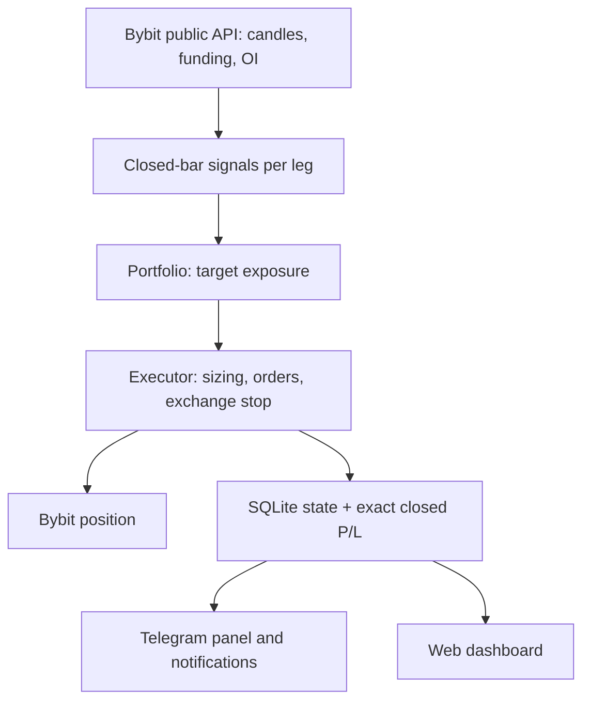
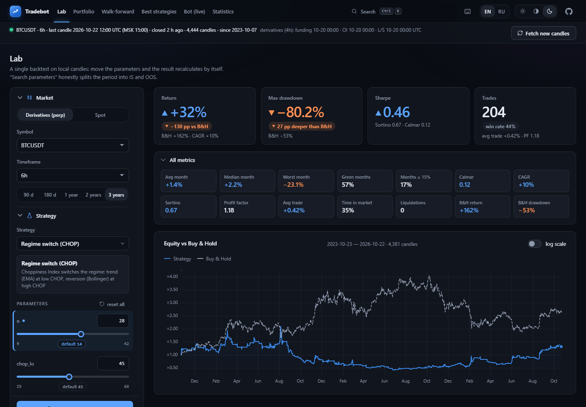
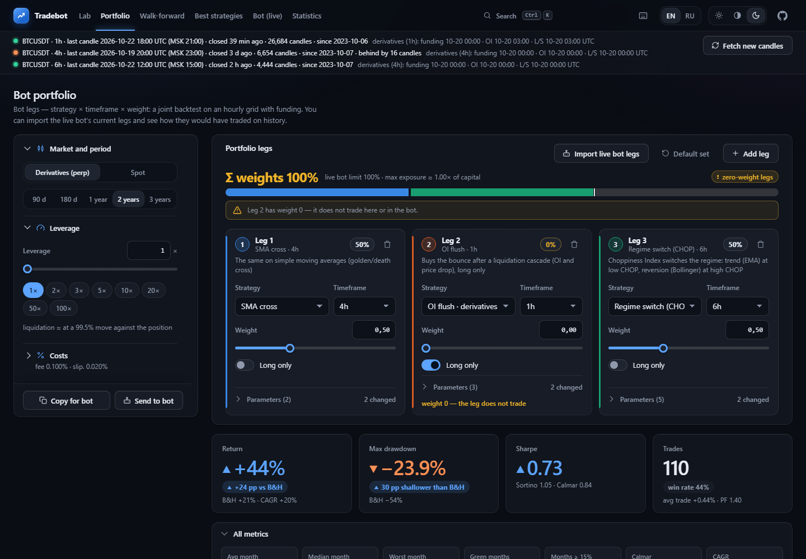

# 📈 Bybit Regime Bot

> BTCUSDT perpetual trading bot for Bybit with a built-in strategy lab: Telegram control, web dashboard, exchange-side stop and kill-switch.

🌐 **Язык / Language:** [Русский](README_RU.md) · [English](README.md)


## 📌 Overview

The project has two halves that share one code base:

- **A trading bot** for the Bybit BTCUSDT perpetual (isolated margin, one-way mode, Unified Trading Account). Every hour it evaluates strategy signals on closed candles, derives a target position, and brings the exchange position to it. A protective stop always sits on the exchange. The bot is controlled from Telegram.
- **A local lab and dashboard** to backtest 32 built-in strategies, combine them into a weighted portfolio ("legs"), check them walk-forward and out-of-sample, and watch the live bot and its statistics.

The same strategy and engine code is used by the backtester and the live bot, and a parity test keeps them identical.

> [!WARNING]
> **The bot trades on Bybit mainnet with real money, using the whole account balance.** There is no testnet or paper mode. Strategies do not guarantee profit and you can lose the entire deposit. Backtests are hypothetical. This is not financial advice; the code is provided as is, and you are responsible for your keys, leverage and risk limits.

> [!NOTE]
> The dashboard and the console speak English and Russian: English by default, switch the dashboard with the **EN | RU** control in its header and set the default (dashboard and console) with `APP_LANGUAGE` in `.env`. The Telegram panel is Russian only for now.

## ✨ Features

- 🤖 **Hourly decision loop** on closed bars: signals → target exposure → sized order → exchange position. Signals only change when a strategy's own bar closes (for example every 6 hours), so no intrabar noise.
- 🧩 **Portfolio of legs:** strategy × timeframe × weight, edited live from Telegram or pushed from the dashboard ("Send to bot") with a confirmation step.
- 🛡️ **Protection:** exchange-side stop on every position, kill-switch on drawdown from peak and on daily loss, API-key preflight (trading is blocked if the key can withdraw or is read-only), single-instance lock, hard leverage cap of 3×.
- 📟 **Telegram control panel:** one self-updating message (Home / Position / Signals), risk settings, leg editor, trade notifications with P/L in dollars and in percent of the account, daily summary. Owner-only.
- 📊 **Web dashboard** (dark and light theme, `Ctrl+K` palette): Lab, Portfolio, Walk-forward, Best strategies, Live, Statistics.
- 🌐 **Two languages:** English (default) and Russian for the dashboard and the console, chosen in `.env` (`APP_LANGUAGE`); the dashboard also has an EN | RU switch that remembers your choice.
- 🧮 **Exact P/L:** closed trades are reconciled with Bybit `closed-pnl` (fees and funding included), so the dashboard and Telegram show the same dollars.
- 🔬 **Honest research tools:** in-sample/out-of-sample split, walk-forward, verdicts that flag overfitting, fees at 0.1 % by default, slippage, funding, liquidation model, leverage up to 100×.
- 💾 **Operations:** SQLite (WAL) state with schema migrations, daily backups, log rotation, restart wrapper, read-only `--check`, optional heartbeat watchdog.

## 🏗️ How it works



Position size is recomputed only when the target exposure or leverage changes: `qty = round_down(|exposure| × balance × 0.97 × leverage / price, lot step)`, where `balance` is the smaller of the USDT wallet balance and equity.

### Example strategy: Regime switch (CHOP)

The Choppiness Index (CHOP) decides which behaviour is allowed on each bar:

| CHOP | Regime | Position |
| --- | --- | --- |
| below 45 | trending | follow the sign of EMA(fast) − EMA(slow) |
| above 55 | ranging | Bollinger(20, 2) mean reversion, hold until the middle band |
| between | unclear | flat |

Being flat for days is normal for this kind of strategy.

### Built-in strategies (32)

Trend (EMA/SMA cross, Supertrend, Donchian, Keltner, Ichimoku, Parabolic SAR, KAMA, MA ribbon), mean reversion (RSI, Bollinger, z-score, Connors RSI(2)), momentum (MACD, ROC, vol-targeted TSMOM), regime and volatility (CHOP switch, squeeze breakout, ADX filter), and derivative-based (funding, long/short ratio, open interest). Full list with parameters: the Lab tab.

## 🖼️ Screenshots

Backtests on public market data (no account data); they illustrate the UI and are not a performance claim. The dashboard is shown in English; the Russian screenshots are in [README_RU.md](README_RU.md).

**Lab** — one backtest, parameters recompute the result live:



**Portfolio** — legs with weights, combined backtest, "Take live bot legs" / "Send to bot":



## 🚀 Quick start

### Requirements

- Python 3.12+ (developed on 3.14) and Node.js 22+ (only to build the dashboard)
- A Telegram bot token from [@BotFather](https://t.me/BotFather) and your numeric Telegram user id
- A Bybit API key (Unified Trading Account) with **Contract Orders + Positions** permissions and **without Withdraw**
- Windows is the primary target (`run.bat`); the Python code and tests also run on Linux in CI

### Installation

```powershell
git clone https://github.com/soroka01/Bybit-Regime-Bot.git
cd Bybit-Regime-Bot
py -3 -m venv .venv
.\.venv\Scripts\Activate.ps1
pip install -e .[dev]
cd web
npm install
npm run build
cd ..
Copy-Item .env.example .env
```

### Configuration

Fill in `.env` (it is git-ignored and values are never printed):

```dotenv
APP_LANGUAGE=en
TELEGRAM_BOT_TOKEN=<number>:<string>
TELEGRAM_OWNER_ID=123456789
BYBIT_API_KEY=...
BYBIT_API_SECRET=...
TZ_NAME=Europe/Moscow
```

### Verify, then run

```powershell
python -m tradebot.app --check   # read-only: key permissions, account settings, balance, position
run.bat                          # bot + Telegram + dashboard, restarts after crashes
```

`--check` sends only GET requests (no orders, no Telegram, no database) and exits with `0` if everything is fine, `4` on a configuration/key/account problem, `1` if the exchange is unreachable.

Trading is **off** after the first start: open the Telegram panel, review the risk settings and legs, and enable it explicitly. The dashboard is served at <http://127.0.0.1:8000>.

### Dashboard only (no keys, no trading)

```powershell
python -m tradebot.web
```

On first launch the Lab offers to download candles from Bybit's public API. This mode reads only `APP_LANGUAGE` from `.env` (no keys needed).

## ⚙️ Configuration

| Variable | Required | Description |
| --- | :---: | --- |
| `TELEGRAM_BOT_TOKEN` | yes | Bot token from @BotFather |
| `TELEGRAM_OWNER_ID` | yes | Numeric id of the only user who can control the bot |
| `BYBIT_API_KEY`, `BYBIT_API_SECRET` | yes | Mainnet key; both are required |
| `APP_LANGUAGE` | no | `en` (default) or `ru`: language of the console, logs, `--check` report and the dashboard default. Any other value stops startup (exit code 4). Telegram stays Russian |
| `TZ_NAME` | no | Time zone for Telegram messages (default `Europe/Moscow`) |

Runtime settings live in the bot database and are changed from Telegram (ranges are validated server-side):

| Setting | Default | Range |
| --- | ---: | --- |
| Leverage | 1× | 1–3× (hard cap in code) |
| Exchange stop | 8 % | 1–30 % |
| Kill-switch: drawdown from peak | 25 % | 5–50 % |
| Kill-switch: daily loss | 10 % | 2–30 % |

The config is mainnet-only and fail-closed: `PAPER` or `BYBIT_ENV=testnet` in `.env` stop the start with exit code 4.

## 🔒 Security & privacy

- Only `TELEGRAM_OWNER_ID` can control the bot; other chats are ignored.
- Use a key **without** the Withdraw permission. At start the bot inspects the key and blocks trading if it can withdraw or is read-only. IP binding is optional.
- The dashboard listens on `127.0.0.1` only and checks `Sec-Fetch-Site`, content types and security headers.
- `.env`, `storage/` (database, candles, logs, backups) and build output are git-ignored. The database contains your trading history: do not publish it.
- Tests use fakes and a blocked network; no real keys are ever needed.

## 🗂️ Project structure

```text
.
├── src/tradebot/
│   ├── i18n.py       # console/API language (APP_LANGUAGE): tr("English text") with Russian translations in i18n_ru.py
│   ├── core/         # backtest engine, indicators, strategies, portfolio (single source of target exposure)
│   ├── market/       # candles, funding, OI, long/short ratio: download and parquet cache
│   ├── research/     # sweeps and walk-forward
│   ├── trading/      # exchange client, executor, runner, risk, SQLite state, P/L
│   ├── telegram/     # aiogram panel, notifications, confirmations
│   └── web/          # FastAPI backend of the dashboard
├── web/              # dashboard frontend (TypeScript + esbuild + uPlot), design rules and i18n in DESIGN.md; texts in src/i18n/messages
├── tools/watchdog.py # optional heartbeat watchdog that alerts via Telegram
├── tests/            # pytest suite with an exchange fake in tests/fakes
├── run.bat           # Windows launcher with restart backoff
└── .env.example      # configuration template without secrets
```

## 🧰 Operations

- **State:** `storage/state/bot.db` (SQLite, WAL). A daily copy goes to `storage/backups/db/bot_YYYYMMDD.db` (14 kept); old logs are pruned and the WAL is truncated.
- **Logs:** `storage/logs/bot.log` (rotating) and `storage/logs/run.log` (exit codes of `run.bat`).
- **Stop:** `Ctrl+C` in the bot window. The position stays on the exchange under its protective stop.
- **Exit codes:** `0` clean stop, `3` another instance is running, `4` configuration error; `run.bat` does not restart on these.
- **Watchdog:** `tools/watchdog.py --once` sends a Telegram alert if the bot goes silent or the exchange is unreachable. Schedule it every 5 minutes with Windows Task Scheduler; the exact `schtasks` command is in the file's docstring.

## 🧪 Development

```powershell
python -m pytest -q tests          # fast default suite
python -m pytest -q tests -m ""    # everything, including timing and real-data tests
cd web; npm run typecheck; npm test
```

Tests never touch the network. Keep real keys out of tests; the tree must stay importable and pass the fast suite at any time.

## ⚠️ Limitations

- One symbol (BTCUSDT linear perpetual), one process, one Unified Account, isolated margin, one-way mode.
- Market orders only, so taker fees apply; backtests assume 0.1 % per side plus slippage (change it in the Lab to match your fee tier).
- Signals are defined on closed bars. Re-evaluating on a rolling bar looks attractive but loses to noise and fees in backtests.
- The Telegram interface is Russian only (the dashboard and the console are bilingual). Trade reasons and notification texts that the bot stores in its database are Russian and are shown as stored (known trade reasons are translated in the English dashboard).
- Past performance, backtests and walk-forward results do not predict future returns.

## 📄 License

[MIT](LICENSE).

## 💬 Support

You can [fork the repository](https://github.com/soroka01/Bybit-Regime-Bot/fork) and adapt it. If it was useful, give it a [Star](https://github.com/soroka01/Bybit-Regime-Bot): it shows me the project helped someone.

---

with love ❤️
