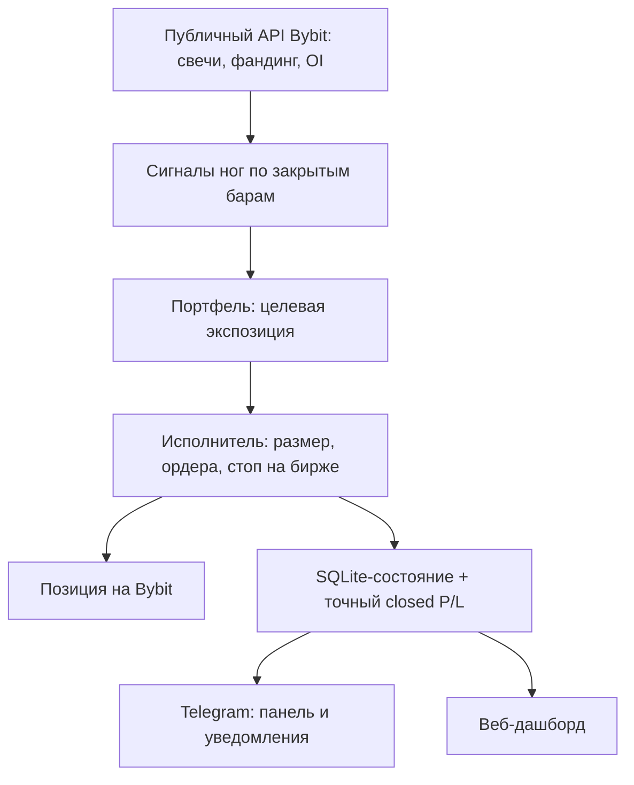
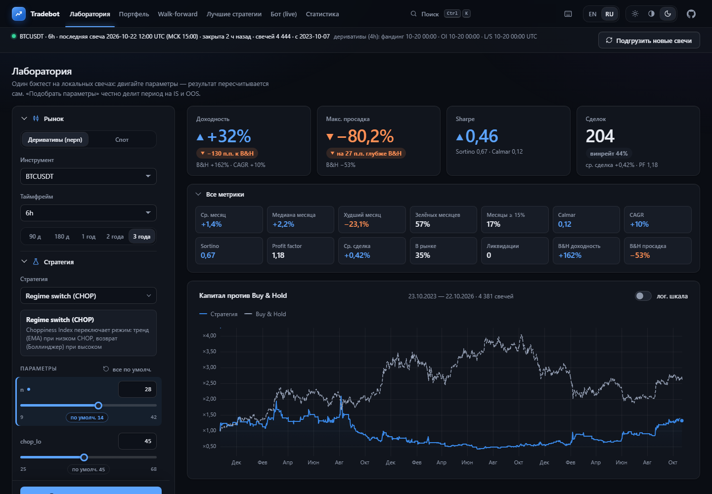
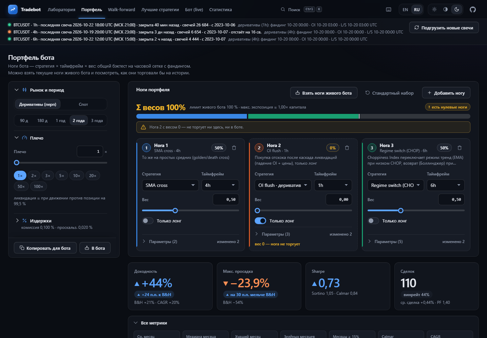

# 📈 Bybit Regime Bot

> Бот для торговли бессрочным контрактом BTCUSDT на Bybit со встроенной лабораторией стратегий: управление из Telegram, веб-дашборд, защитный стоп на бирже и kill-switch.

🌐 **Язык / Language:** [Русский](README_RU.md) · [English](README.md)


## 📌 Обзор

В проекте две части на одной кодовой базе:

- **Торговый бот** для бессрочного контракта BTCUSDT на Bybit (изолированная маржа, односторонний режим, единый торговый аккаунт UTA). Каждый час он считает сигналы стратегий по закрытым свечам, определяет целевую позицию и приводит к ней позицию на бирже. Защитный стоп на бирже стоит всегда. Управление - из Telegram.
- **Локальная лаборатория и дашборд**: бэктест 32 встроенных стратегий, сборка взвешенного портфеля («ног»), проверка walk-forward и вне выборки, просмотр живого бота и его статистики.

Бэктестер и живой бот используют один и тот же код стратегий и движка, а тест на паритет следит, чтобы они не разошлись.

> [!WARNING]
> **Бот торгует на основной сети Bybit (mainnet) на реальные деньги, всем балансом счёта.** Тестовой сети и режима «бумажной» торговли нет. Стратегии не гарантируют прибыли, можно потерять весь депозит. Бэктесты - гипотетические. Это не инвестиционная рекомендация; код предоставляется как есть, за ключи, плечо и риск-лимиты отвечаете вы.

> [!NOTE]
> Дашборд и консоль двуязычные: по умолчанию английский; дашборд переключается кнопками **EN | RU** в шапке, а язык по умолчанию (дашборда и консоли) задаёт `APP_LANGUAGE` в `.env`. Панель Telegram пока только на русском.

## ✨ Возможности

- 🤖 **Часовой цикл решений** по закрытым барам: сигналы → целевая экспозиция → размер ордера → позиция на бирже. Сигнал меняется только при закрытии собственного бара стратегии (например, раз в 6 часов), без шума внутри свечи.
- 🧩 **Портфель из ног:** стратегия × таймфрейм × вес; правится на лету из Telegram или отправляется с дашборда кнопкой «В бота» с подтверждением.
- 🛡️ **Защита:** стоп на бирже на каждую позицию, kill-switch по просадке от пика и по дневному убытку, проверка прав ключа при старте (торговля блокируется, если ключ может выводить средства или только читает), блокировка второго экземпляра, жёсткий потолок плеча 3×.
- 📟 **Панель в Telegram:** одно обновляемое сообщение (Главная / Позиция / Сигналы), настройки риска, редактор ног, уведомления о сделках с P/L в долларах и в процентах от счёта, итоги дня. Только для владельца.
- 📊 **Веб-дашборд** (тёмная и светлая темы, палитра `Ctrl+K`): Лаборатория, Портфель, Walk-forward, Лучшие стратегии, Бот (live), Статистика.
- 🌐 **Два языка:** английский (по умолчанию) и русский для дашборда и консоли, выбор в `.env` (`APP_LANGUAGE`); в дашборде есть и переключатель EN | RU, он запоминает выбор.
- 🧮 **Точный P/L:** закрытые сделки сверяются с Bybit `closed-pnl` (комиссии и фандинг учтены), поэтому на сайте и в Telegram одни и те же доллары.
- 🔬 **Честные инструменты исследования:** деление на выборку и «вне выборки», walk-forward, вердикты, помечающие подгонку, комиссия 0,1 % по умолчанию, проскальзывание, фандинг, модель ликвидации, плечо до 100×.
- 💾 **Эксплуатация:** состояние в SQLite (WAL) с миграциями схемы, ежедневные копии, ротация логов, обёртка с перезапуском, проверка `--check` только на чтение, опциональный сторож пульса.

## 🏗️ Как это работает



Размер позиции пересчитывается только при смене целевой экспозиции или плеча: `qty = округление_вниз(|экспозиция| × баланс × 0,97 × плечо / цена, шаг лота)`, где `баланс` - меньшее из USDT wallet balance и equity.

### Пример стратегии: Regime switch (CHOP)

Индекс Choppiness (CHOP) на каждом баре решает, какое поведение разрешено:

| CHOP | Режим | Позиция |
| --- | --- | --- |
| ниже 45 | тренд | по знаку EMA(быстрая) − EMA(медленная) |
| выше 55 | боковик | возврат к средней по Боллинджеру (20, 2), удержание до средней линии |
| между | неясно | вне рынка |

Для такой стратегии нормально сидеть вне рынка несколько дней подряд.

### Встроенные стратегии (32)

Тренд (EMA/SMA cross, Supertrend, Donchian, Keltner, Ichimoku, Parabolic SAR, KAMA, MA ribbon), возврат к средней (RSI, Bollinger, z-score, Connors RSI(2)), импульс (MACD, ROC, TSMOM с таргетом волатильности), режим и волатильность (переключатель CHOP, squeeze breakout, фильтр ADX), по деривативам (фандинг, соотношение лонг/шорт, open interest). Полный список с параметрами - во вкладке «Лаборатория».

## 🖼️ Скриншоты

Бэктесты на публичных рыночных данных (данных счёта нет); они показывают интерфейс и не являются обещанием доходности. Дашборд показан на русском; английские скриншоты - в [README.md](README.md).

**Лаборатория** - один бэктест, параметры пересчитывают результат на лету:



**Портфель** - ноги с весами, общий бэктест, «Взять ноги живого бота» / «В бота»:



## 🚀 Быстрый старт

### Требования

- Python 3.12+ (разработка на 3.14) и Node.js 22+ (только для сборки дашборда)
- Токен Telegram-бота от [@BotFather](https://t.me/BotFather) и ваш числовой Telegram id
- API-ключ Bybit (единый торговый аккаунт) с правами **Contract Orders + Positions** и **без права вывода (Withdraw)**
- Основная платформа - Windows (`run.bat`); код на Python и тесты также проходят на Linux в CI

### Установка

```powershell
git clone https://github.com/soroka01/Bybit-Regime-Bot.git
cd Bybit-Regime-Bot
py -3 -m venv .venv
.\.venv\Scripts\Activate.ps1
pip install -e .[dev]
cd web
npm install
npm run build
cd ..
Copy-Item .env.example .env
```

### Конфигурация

Заполните `.env` (он в `.gitignore`, значения нигде не печатаются):

```dotenv
APP_LANGUAGE=en
TELEGRAM_BOT_TOKEN=<число>:<строка>
TELEGRAM_OWNER_ID=123456789
BYBIT_API_KEY=...
BYBIT_API_SECRET=...
TZ_NAME=Europe/Moscow
```

### Проверка и запуск

```powershell
python -m tradebot.app --check   # только чтение: права ключа, настройки аккаунта, баланс, позиция
run.bat                          # бот + Telegram + дашборд, перезапуск после падений
```

`--check` отправляет только GET-запросы (без ордеров, Telegram и базы данных) и завершается кодом `0`, если всё в порядке, `4` - при проблеме конфигурации, ключа или аккаунта, `1` - если биржа недоступна.

После первого запуска торговля **выключена**: откройте панель в Telegram, проверьте настройки риска и ноги и включите её явно. Дашборд доступен по адресу <http://127.0.0.1:8000>.

### Только дашборд (без ключей, без торговли)

```powershell
python -m tradebot.web
```

При первом запуске лаборатория предложит скачать свечи с публичного API Bybit. В этом режиме из `.env` читается только `APP_LANGUAGE` (ключи не нужны).

## ⚙️ Конфигурация

| Переменная | Обязательна | Описание |
| --- | :---: | --- |
| `TELEGRAM_BOT_TOKEN` | да | Токен бота от @BotFather |
| `TELEGRAM_OWNER_ID` | да | Числовой id единственного пользователя, который управляет ботом |
| `BYBIT_API_KEY`, `BYBIT_API_SECRET` | да | Ключ основной сети; нужны оба значения |
| `APP_LANGUAGE` | нет | `en` (по умолчанию) или `ru`: язык консоли, логов, отчёта `--check` и язык дашборда по умолчанию. Любое другое значение останавливает запуск (код 4). Telegram остаётся русским |
| `TZ_NAME` | нет | Часовой пояс для сообщений Telegram (по умолчанию `Europe/Moscow`) |

Настройки времени работы хранятся в базе бота и меняются из Telegram (диапазоны проверяются на стороне бота):

| Настройка | По умолчанию | Диапазон |
| --- | ---: | --- |
| Плечо | 1× | 1-3× (жёсткий потолок в коде) |
| Стоп на бирже | 8 % | 1-30 % |
| Kill-switch: просадка от пика | 25 % | 5-50 % |
| Kill-switch: дневной убыток | 10 % | 2-30 % |

Конфиг только для mainnet и fail-closed: `PAPER` или `BYBIT_ENV=testnet` в `.env` останавливают запуск с кодом 4.

## 🔒 Безопасность и приватность

- Ботом управляет только `TELEGRAM_OWNER_ID`; остальные чаты игнорируются.
- Используйте ключ **без** права Withdraw. При старте бот проверяет ключ и блокирует торговлю, если он может выводить средства или только читает. Привязка по IP необязательна.
- Дашборд слушает только `127.0.0.1` и проверяет `Sec-Fetch-Site`, типы содержимого и заголовки безопасности.
- `.env`, `storage/` (база, свечи, логи, копии) и результат сборки в `.gitignore`. База содержит историю ваших сделок: не публикуйте её.
- Тесты работают на заглушках и с заблокированной сетью; настоящие ключи не нужны.

## 🗂️ Структура проекта

```text
.
├── src/tradebot/
│   ├── i18n.py       # язык консоли и API (APP_LANGUAGE): tr("English text"), русские переводы в i18n_ru.py
│   ├── core/         # движок бэктеста, индикаторы, стратегии, портфель (единый источник целевой экспозиции)
│   ├── market/       # свечи, фандинг, OI, соотношение лонг/шорт: загрузка и parquet-кэш
│   ├── research/     # перебор параметров и walk-forward
│   ├── trading/      # клиент биржи, исполнитель, раннер, риск, SQLite-состояние, P/L
│   ├── telegram/     # панель aiogram, уведомления, подтверждения
│   └── web/          # FastAPI-бэкенд дашборда
├── web/              # фронтенд дашборда (TypeScript + esbuild + uPlot), правила дизайна и i18n в DESIGN.md; тексты в src/i18n/messages
├── tools/watchdog.py # опциональный сторож пульса, пишет в Telegram
├── tests/            # pytest-набор, двойник биржи в tests/fakes
├── run.bat           # Windows-запуск с бэкоффом перезапусков
└── .env.example      # шаблон конфигурации без секретов
```

## 🧰 Эксплуатация

- **Состояние:** `storage/state/bot.db` (SQLite, WAL). Раз в сутки копия уходит в `storage/backups/db/bot_YYYYMMDD.db` (хранятся 14), старые журналы чистятся, WAL усекается.
- **Логи:** `storage/logs/bot.log` (с ротацией) и `storage/logs/run.log` (коды выхода `run.bat`).
- **Остановка:** `Ctrl+C` в окне бота. Позиция остаётся на бирже под защитным стопом.
- **Коды выхода:** `0` штатная остановка, `3` запущен другой экземпляр, `4` ошибка конфигурации; на них `run.bat` не перезапускает.
- **Сторож:** `tools/watchdog.py --once` присылает алерт в Telegram, если бот замолчал или биржа недоступна. Запускайте его раз в 5 минут через Планировщик заданий Windows; точная команда `schtasks` - в docstring файла.

## 🧪 Разработка

```powershell
python -m pytest -q tests          # быстрый набор по умолчанию
python -m pytest -q tests -m ""    # всё, включая тесты на время и на реальных данных
cd web; npm run typecheck; npm test
```

Тесты не ходят в сеть. Не подставляйте в тесты настоящие ключи; дерево должно всегда импортироваться и проходить быстрый набор.

## ⚠️ Ограничения

- Один инструмент (линейный бессрочный BTCUSDT), один процесс, один единый аккаунт, изолированная маржа, односторонний режим.
- Только рыночные ордера, поэтому действует комиссия тейкера; бэктесты считают 0,1 % с каждой стороны плюс проскальзывание (подстройте под свой тариф в лаборатории).
- Сигналы определены по закрытым барам. Пересчёт по скользящему бару выглядит заманчиво, но в бэктестах проигрывает шуму и комиссиям.
- Интерфейс Telegram - только на русском (дашборд и консоль двуязычные). Причины сделок и тексты уведомлений, которые бот хранит в базе, русские и показываются как сохранены (известные причины сделок в английском дашборде переводятся).
- Прошлые результаты, бэктесты и walk-forward не предсказывают будущую доходность.

## 📄 Лицензия

[MIT](LICENSE).

## 💬 Поддержка

Можно [форкнуть репозиторий](https://github.com/soroka01/Bybit-Regime-Bot/fork) и доработать под себя. Если проект пригодился, поставьте [Star](https://github.com/soroka01/Bybit-Regime-Bot) - так я увижу, что он был кому-то полезен.

---

with love ❤️
